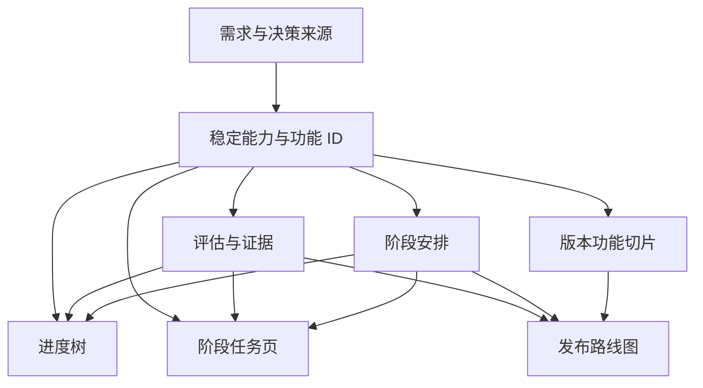

# 数据契约与派生视图

用于没有现有数据模型的新项目。已有能力编号和 JSON/数据库契约时保留其结构，用本节的不变量核对、补齐或适配；不要直接套脚本并强制迁移。

## 1. 持久化与文件组织

小团队、评审驱动的规划可用 Git 管理 JSON/YAML：变更可审阅，版本可回查，静态站无需数据库。多人实时编辑、权限分工或审批需求明确时，可用数据库保存同样的逻辑记录，并提供稳定 ID、并发保护、历史和导出；不可同时让数据库与仓库各有一套“权威状态”。

本 Skill 的可运行示例使用单个 JSON，降低迁移和验证成本；真实项目可按来源、能力、进度、阶段、版本分文件，通过 ID 关联。拆分只改变物理组织，不改变数据来源的唯一性。

入口为 `schemaVersion: 1`。顶层字段：

| 字段 | 作用 |
| --- | --- |
| `project` | `name` 与 `example`；示例必须为 true，真实记录为 false |
| `review` | 本轮模式、代码区间、日期、已复核能力和未覆盖范围 |
| `sources` | 有稳定 ID 的需求、代码、测试、实测、部署等证据 |
| `decisions` | 待确认事项、决策与来源；不把计划安排当确认 |
| `capabilities` | PB/PD/PT 能力及其功能、默认阶段和实现评估 |
| `phases` | 产品阶段的目标与出口，数量和名称由项目决定 |
| `releases` | 小版本结果、功能切片、依赖与验收 |
| `backlog` | 尚无完整交付目标的功能 ID，显式保留未排期 |

`assets/capability-map.example.json` 是虚构预约项目，含教学假设与示意路径。可参考结构，不可用其事实填充真实项目。

## 2. 来源与决策

`sources` 每项：`id`、`kind`、`locator`、`revision`、`summary`。

- `kind`：`requirement`、`decision`、`prototype`、`code`、`inspection`、`test`、`manual`、`deployment`、`example`。
- `locator` 是文件/页面/执行记录定位；有条件时补符号或行号。不要只写“看过代码”。
- `revision` 记录需求版本、代码提交或测试/发布记录版本，缺证据不造 SHA。
- `code` 来源另有 `path`，为仓库相对文件路径；`--repo` 可核验其在指定提交存在。
- `inspection` 可记录限定范围内的检索、链路和缺失结论；检索无结果不能等同全仓未实现。
- `test/manual/deployment` 的 summary 记录实际结果、环境和覆盖；引用一个测试文件不是证明测试已运行。
- `example` 仅在教学数据中允许。

`decisions` 每项：`id`、`question`、`state`（`open/confirmed/rejected`）、`answer`、`sourceIds`。未决答复用 null；已确认/拒绝需答复与来源。确认了免费预约，不会顺带确认收费、取消赔付或信用政策。

## 3. 能力与细功能

能力字段：

- `id`：稳定编号，示例采用 `PB01.01`；`layer` 为 PB/PD/PT，`group` 为大模块名称，`title` 为小模块职责。
- `requires`：依赖的其他能力 ID。仅表达实施前置条件，须无环；共用/关联关系不必视为前置，可另扩 `relatedIds` 并单独校验。
- `phaseId`：默认完整目标的阶段，未安排用 null。个人试排覆盖另存，不覆盖团队值。
- `functions`：功能列表，每项有 `id`、`title`、`requirementState`、`sourceIds`、`decisionIds` 和 `acceptance`。
- `assessment`：小模块级实现评估，见下一节。

功能 ID 在示例采用 `PB01.01.01`，其父能力为 `PB01.01`。本示例 schema 要求能力 ID 以 layer 为前缀，功能 ID 以所属能力 ID 加点号为前缀；不强制两位数字。`requirementState` 是 `confirmed/proposed/open/rejected/retired`；确认依据与实现状态独立。

已确认功能应有可核对的验收条目；未确认范围可以有空验收，但必须留决策和后续条件。被拒绝/退役功能保留 ID 及历史，不继续列入活动版本；未排期功能进入 backlog。新模块允许无功能条目，但只能作为未评估、未排期的目标占位，不能创造实现进度。

跨层关系可用 PB.requires → PD、PT；PT 或 PD 自身也可有合理前置。不要为了画三层树而制造循环依赖。若确实需要并行共同交付，用同版功能切片表达，不把相互引用都写成“必须先完成”。

## 4. 评估拆成独立维度

| 字段 | 值与含义 |
| --- | --- |
| `implementation` | `not_assessed` 未评估；`not_implemented` 已检查但未找到对应实现；`stub` 占位；`reusable` 有可复用基础；`partial` 部分实现；`implemented` 当前定义范围已实现 |
| `validation` | `not_run/partial/passed/failed`，针对已说明的检查范围 |
| `deployment` | `unknown/not_deployed/deployed`，限定具体环境与版本 |
| `acceptance` | `not_run/passed/failed`，针对当前业务验收标准 |
| `present` / `gaps` | 已有行为与剩余缺口，数组；已实现也可仍有验收/发布缺口 |
| `evidenceIds` | 关联 sources，不在每页另写一份证据 |
| `reviewedAt` / `codeRef` | 该能力最近一次评估日期与代码版本；未评估可为 null |
| `freshness` | `current/stale`；受变更影响但尚未复核时保留旧评估并标 stale |

“已实现”不能由测试数量、分支合并或一次部署推导。通过测试也不自动是上线或业务验收通过。可以出现“已实现＋验证失败”，应解释缺口；不要硬拼成单一绿色完成状态。

脚本要求非未评估的实现结论有代码/检索证据，执行过的验证有 test/manual 记录，已部署有 deployment 记录，执行过的业务验收有 manual 记录。它只检查关联类型和字段，不能判断记录真伪或覆盖充分性。

父节点汇总数量或状态分布，不将 PB/PD/PT 加成开发百分比。功能不自动继承父能力的已实现评级。需要功能级评级时新增同样的独立评估记录，并调整 UI 和检查；不能偷偷提高展示粒度。

## 5. 阶段与小版本

`phases`：`id/title/goal/exitCriteria`。产品阶段出口由实际业务决定，不固定为 P0–P3，也不固定为增长、PGC 或 UGC。

`releases` 每项包括：

- `id/title/phaseId` 与 `state`（`candidate/planned`）：候选与已纳入近期计划的范围分开；发布/验收事实存证据，不能把 planned 当已发布。
- `outcome`：一条可观察的用户结果。
- `dependsOn`：其他版本 ID，无循环；非版本条件写 `entryCriteria`。
- `deliveries`：`featureId/mode/scope/acceptance`。
- `entryCriteria/acceptance/outOfScope/remainingWork`：进入条件、全版验收、不做什么、剩余工作。
- `measure/rollout/rollback`：如何测量效果、部署/启用与回退要求；不适用时明确说明原因。
- `estimate` 可选：按已知剩余工作与实际产能估算，附假设，不能自动按模块数计算。

`mode`：`complete` 是所列功能的完整目标落点；`slice` 是明确子范围；`reuse` 是复用且需验证适用性的基础。同一模块中功能可分散到不同 R/阶段，不是整个模块每次重建。

每个有效功能有且仅有一个 complete 落点，或明确进入 backlog；可以同时有多次 slice/reuse 引用。未确认功能可在 candidate 中讨论，不能直接进入 planned 的承诺范围；功能所关联的决策仍为 open 时，也不能用 confirmed 标签绕过。decisionIds 应只引用决定该功能范围的决策，非阻塞的远期讨论另存关联说明。拒绝/退役功能从活动版本移出。

若一个基础模块默认早期阶段、其高级功能较晚交付，应保留对应关系并解释，不能因阶段差异自动判错或重排版本。模块依赖与版本顺序需人工核对到本次切片的必需范围。

## 6. 本轮复核记录

`review` 包含：`mode`（`initial/incremental/planning`）、`from`、`to`、`date`、`scope`、`reviewedCapabilityIds`、`excluded`。

真实源码评估使用完整 Git SHA（SHA-1 为 40 位，SHA-256 为 64 位）；解析分支或短引用后保存完整值，不把浮动引用或短 SHA 当持久基线。初始无代码时 `to` 可为 null，能力保持未评估。增量须有起止 SHA。仅排期可以保留已有能力的旧 codeRef、reviewedAt，不能重写成新评估。

`review.scope` 为字符串，`review.excluded` 为字符串数组；各阶段 `exitCriteria`、功能/切片验收以及版本的 `entryCriteria/acceptance/outOfScope/remainingWork/measure/rollout/rollback` 均为字符串数组。

`reviewedCapabilityIds` 只列此次实质复核并更新证据的能力，其 codeRef 和 reviewedAt 与本轮对应。受影响但未完成复核的能力标 stale，写入 excluded，不冒充已检查。

当前评估快照随 Git 演进，历史通过提交或项目自己的复核日志追踪；重大需求/ID迁移另存变更说明。不要只留下最后一段“已同步”，让起止范围不可回查。

## 7. 页面/工具应如何读取

共享访问层负责 ID 查找、评级、阶段和引用；视图不另存实现状态副本。展示要求：状态文字配颜色、图例和维度；能看已有/待补及证据；能追到功能与发布范围；搜索、展开和稳定链接不因改名/换阶段失效。

如果只需静态报告，可以生成表格/Mermaid，并标生成基线和来源；不要为了使用方法论要求先搭完整交互站点。用户要求现有进度树/网站同步时，必须检查实际组件和站点产物。

脚本默认离线、只读：检查形状、ID/枚举/引用、评估依据、功能目标覆盖和依赖环。`--repo` 额外检查提交和代码路径存在，不联网、不开服务、不自动修复、提交或部署。警告包括教学数据、未评估、stale 和未排期，均不能当作完成。
